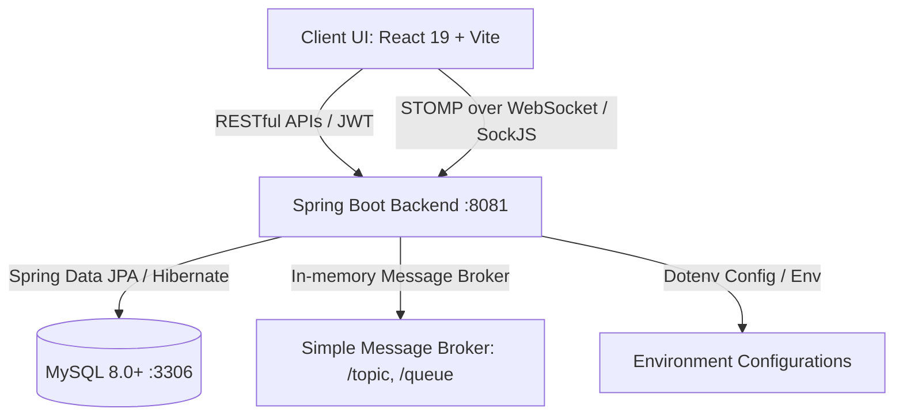

# 💬 Discord-like Real-Time Chat System

A full-stack, enterprise-grade real-time chat platform modeled after **Discord**, built with **Spring Boot 3.4 (Java 21)**, **React 19 (Vite)**, **MySQL 8.0+**, and **STOMP over WebSocket (SockJS)**. Features a hierarchical 3-state role-based permission engine (Allow / Inherit / Deny), polymorphic channels (Guild vs. Direct Messages) using JPA Joined Table Inheritance, real-time message broadcasting, emoji reactions, and secure stateless JWT authentication.

---

## 📑 Table of Contents
- [Key Features](#-key-features)
- [System Architecture](#-system-architecture)
- [Tech Stack](#-tech-stack)
- [Project Structure](#-project-structure)
- [Prerequisites](#-prerequisites)
- [Environment Variables](#-environment-variables)
- [Getting Started](#-getting-started)
  - [Method 1: Run with Docker Compose (Đang cập nhật)](#method-1-run-with-docker-compose-đang-cập-nhật)
  - [Method 2: Run Manually (Local Development)](#method-2-run-manually-local-development)
- [Default Accounts & Initial Data](#-default-accounts--initial-data)
- [API Documentation](#-api-documentation)
- [License](#-license)

---

## 🌟 Key Features

### 👤 User & Social
- **Authentication & Security:** User registration, login with stateless JWT tokens, BCrypt password hashing, and token-based protected endpoints.
- **Friend System:** Send, accept, or decline friend requests; maintain a bidirectional friends list with real-time online/offline status tracking.
- **Direct Messaging (DM):** Real-time 1-on-1 private messaging and multi-recipient Group DMs with dynamic conversation updates (`lastMessageAt`).

### 🛡️ Server & Channel Management (Discord-Style)
- **Server (Guild) Operations:** Create community servers, customize avatars, auto-generate unique 8-character invite codes, and manage server members (including member nicknames, kicking, and banning).
- **Channel Categories & Polymorphic Types:**
  - Categorize channels under collapsible groups (`ChannelGroup`).
  - Text Channels (`GUILD_TEXT`) and Announcement Channels (`GUILD_ANNOUNCEMENT`).
  - Private Channels with automatic lock icons (🔒) and role-specific access whitelisting.
- **Discord Hierarchical Tri-State Permission Engine:**
  - Define custom server roles with custom hex colors and hierarchy positions (`position`).
  - Configure granular 3-state permission overrides on individual channels: **Allow (`✓`)**, **Inherit (`／`)**, and **Deny (`✕`)**.
  - Dynamic resolution: Base Server Roles $\rightarrow$ `@everyone` override $\rightarrow$ Specific Role overrides.
  - Context-aware permissions: View Channel (`READ_MESSAGE`), Send Messages (`SEND_MESSAGE`), Manage Channel (`MANAGE_CHANNEL`), Manage Messages (`MANAGE_MESSAGES`), and Create Invites (`INVITE`).

### ⚡ Real-Time Messaging & Interactions
- **WebSocket & STOMP Protocol:** Low-latency bidirectional communication broadcasting instant messages to channel subscribers (`/topic/channel/{id}`).
- **Rich Messaging Experience:**
  - Multi-level message replies (parent-child thread structure via `replyTo`).
  - Pin and unpin important messages with permission checks (`MANAGE_MESSAGES` or server owner).
  - Emoji reaction picker with optimistic UI updates and single-reaction-per-emoji constraint per user.
  - Multi-file and image attachments with preview support.
  - Soft-deletion of messages (author or moderator with `MANAGE_MESSAGES`).
  - Reverse chronological message pagination (`Pageable`) for optimal memory and bandwidth usage.

---

## 🏛️ System Architecture



---

## 💻 Tech Stack

| Layer | Technologies |
| :--- | :--- |
| **Frontend** | React 19, Vite, Axios, StompJS (`@stomp/stompjs`), SockJS-client, Lucide React, Modern CSS Tokens |
| **Backend** | Spring Boot 3.4.1, Java 21, Spring Security 6, Spring Data JPA, Hibernate, WebSocket / STOMP |
| **Database** | MySQL 8.0+ (InnoDB, UTF8mb4 Unicode) |
| **Authentication & Security** | Stateless JWT (`io.jsonwebtoken:jjwt 0.12.6`), BCrypt Password Encoder, CORS Configuration |
| **Environment & Config** | Dotenv-Java (`io.github.cdimascio:dotenv-java`), Spring Boot Profiles |
| **API Documentation** | Springdoc OpenAPI / Swagger UI 2.6.0 |
| **DevOps & Containers** | *(Đang cập nhật - Docker & Docker Compose)* |

---

## 📂 Project Structure

```text
ChatSystem/
├── backend/                              # Spring Boot REST API & WebSocket server
│   ├── src/main/java/com/dev/chatsystem/
│   │   ├── config/                       # SecurityConfig, WebSocketConfig, JwtAuthenticationFilter
│   │   ├── controller/                   # Auth, Channel, Chat, Friend, Server, WebSocket controllers
│   │   ├── dto/                          # Request & Response payload DTOs
│   │   ├── exception/                    # GlobalExceptionHandler, Custom AppExceptions, ErrorCodes
│   │   ├── model/                        # JPA Entities (User, Server, GuildChannel, DMChannel, Message, etc.)
│   │   ├── repository/                   # Spring Data JPA Repositories
│   │   ├── security/                     # JwtService, ChannelPermissionEvaluator, CustomUserDetailsService
│   │   └── service/                      # Business interfaces & Service implementations
│   ├── src/main/resources/               # application.yaml
│   ├── .env.example                      # Sample backend environment configuration
│   └── pom.xml                           # Maven dependencies (Java 21, Spring Boot 3.4.1)
├── frontend/                             # React 19 Single Page Application
│   ├── src/
│   │   ├── api/                          # Axios API clients & WebSocket connection service
│   │   ├── components/                   # Reusable UI components (Avatar, Button, Input, Modal, Feedback)
│   │   ├── config/                       # Constants & permission definitions
│   │   ├── contexts/                     # AuthContext & global providers
│   │   ├── features/                     # Modals (Permissions, Create Channel, Server Roles), Chat, Friends
│   │   ├── layout/                       # ServerRail (72px), ChannelSidebar (240px)
│   │   └── styles/                       # Discord dark theme design tokens & layout CSS
│   ├── package.json                      # Frontend dependencies
│   └── vite.config.js                    # Vite configuration
├── database/                             # Database initialization scripts
│   └── init.sql                          # MySQL schema definitions and relational constraints
├── .gitignore                            # Git ignore rules for compiled classes, node_modules, and secrets
└── README.md                             # Project documentation
```

---

## ⚙️ Prerequisites

Before getting started, make sure you have the following installed:
- **JDK 21** (Java Development Kit 21)
- **Node.js** (v18.0.0+) and **npm**
- **MySQL Server** (8.0 or higher)
- *Docker & Docker Compose (Tùy chọn - Đang cập nhật)*

---

## 🔐 Environment Variables

Before starting the backend, configure the environment variables:

### Backend Configuration (`backend/.env`)
Copy the sample file in `backend/.env.example` to `backend/.env`:

```bash
cp backend/.env.example backend/.env
```

Review and update the variables to match your local setup:

```env
# Server Port
SERVER_PORT=8081

# Database Configuration (MySQL)
DB_HOST=localhost
DB_PORT=3306
DB_NAME=chat_system
DB_USERNAME=root
DB_PASSWORD=your_mysql_password

# JWT Security
JWT_SECRET=q8vqNqyxISQVeiDi25hsbLK8gV8MHplPs7OSaiRNG5G
JWT_EXPIRATION_MS=86400000
JWT_REFRESH_EXPIRATION_MS=604800000
```

---

## 🚀 Getting Started

### Method 1: Run with Docker Compose (Đang cập nhật)
*(Đang cập nhật cấu hình Docker Compose cho toàn bộ hệ thống Database, Backend và Frontend)*.

---

### Method 2: Run Manually (Local Development)

#### 1. Setup MySQL Database
1. Open your MySQL client (Workbench, DBeaver, or MySQL CLI).
2. Create the database and execute the initialization script:
   ```bash
   mysql -u root -p < database/init.sql
   ```
   *(Or run the queries inside `database/init.sql` directly in your database management tool)*.

#### 2. Run Backend Application
Open a terminal and navigate to the `backend/` directory:

```bash
cd backend

# On Windows:
.\mvnw.cmd clean spring-boot:run

# On Linux / macOS:
./mvnw clean spring-boot:run
```

The Spring Boot backend will start on **`http://localhost:8081`**.

#### 3. Run Frontend Application
Open a second terminal and navigate to the `frontend/` directory:

```bash
cd frontend

# Install dependencies
npm install

# Start Vite development server
npm run dev
```

The React frontend will be accessible at **`http://localhost:5173`**.

---

## 🔑 Default Accounts & Initial Data

You can register new accounts directly from the UI or use any test accounts seeded via `database/init.sql`:

| Role / Type | Email / Username | Password | Purpose |
| :--- | :--- | :--- | :--- |
| **Server Owner** | *(Tự đăng ký qua `/register`)* | *(Mật khẩu đã đăng ký)* | Tạo máy chủ, quản lý vai trò và cấu hình kênh |
| **Member** | *(Gia nhập qua mã mời 8 ký tự)* | *(Mật khẩu đã đăng ký)* | Tham gia giao lưu, chat thời gian thực, kết bạn |

> **Mẹo:** Mở hai cửa sổ trình duyệt (một cửa sổ thông thường và một cửa sổ ẩn danh Incognito) đăng nhập hai tài khoản khác nhau để thử nghiệm tính năng chat trực tiếp thời gian thực, phân quyền kênh và thả cảm xúc emoji tức thì.

---

## 📖 API Documentation

When the backend is running, explore and test the RESTful endpoints via Swagger UI:
- **Interactive Swagger UI:** [http://localhost:8081/swagger-ui/index.html](http://localhost:8081/swagger-ui/index.html)
- **OpenAPI Schema (JSON):** [http://localhost:8081/v3/api-docs](http://localhost:8081/v3/api-docs)

### Core Endpoints Overview:
- `POST /api/auth/register` - User registration
- `POST /api/auth/login` - User authentication (returns JWT token)
- `POST /api/servers` - Create a new community server
- `GET  /api/servers/{serverId}` - Get detailed server info & member roles
- `POST /api/channels/guild` - Create guild text/announcement channel
- `GET  /api/channels/guild/server/{serverId}` - Retrieve accessible channels
- `PATCH /api/channels/{channelId}/privacy` - Toggle private channel status
- `POST /api/channels/{channelId}/permissions` - Set 3-state role permission override
- `GET  /api/chat/channel/{channelId}/messages` - Load paginated channel messages
- `POST /api/chat/channel/{channelId}/messages` - Send text/attachment message (and broadcast via WebSocket)
- `POST /api/friends/request` - Send friend request
- `POST /api/channels/dm` - Get or create 1-on-1 / Group DM conversation

---

## 📄 License

This project is licensed under the [MIT License](LICENSE).
